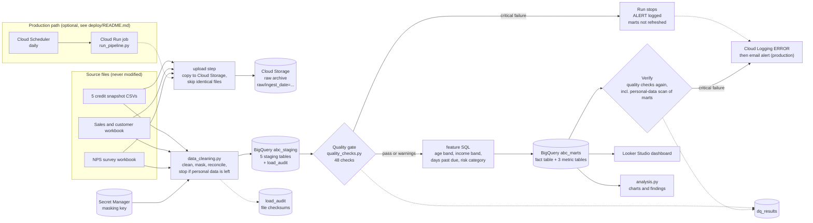

# Pipeline architecture

How the ABC Phones credit data moves from source files to the dashboard, what happens when something goes wrong, and who is told. The picture below is the source for `architecture.png`.

Solid arrows are data flow. Dotted arrows are logging, results and alerts. `scripts/run_pipeline.py` runs the steps in this order: upload, clean, quality, features, marts, verify, analysis.

## 1. Components

| Layer | Tool | Why |
|---|---|---|
| Orchestration | `run_pipeline.py` (Python, calls each script) | Three source files and seven steps do not justify Airflow. Each script also runs on its own |
| Raw archive | Cloud Storage bucket, one dated folder per run | Cheap, replayable, and the original files are never edited |
| Cleaning and masking | Python (pandas) | Messy parsing (mixed date formats, `#N/A`, duplicates, Excel padding) is easier to write and test in Python |
| Secrets | Secret Manager | The masking key never touches a file, the repository or the logs |
| Warehouse | BigQuery: `abc_staging`, `abc_marts` | Serverless, partitioned tables, inside the free tier at this size |
| Features and metrics | BigQuery SQL files | Set-based logic, versioned as text, readable by analysts |
| Quality | SQL checks plus one Python check, results in `dq_results` | The same checks run locally and in the cloud |
| Dashboard | Looker Studio on `abc_marts` | Native BigQuery connector, no hosting |
| Tests | pytest, SQL run in an in-memory DuckDB | No cloud access needed to test the logic |

## 2. Ingestion strategy

- **Full or incremental.** The five credit files are point-in-time snapshots, so the natural unit of loading is one snapshot. Today the pipeline reloads every table in full on each run, which is safe (see "Consistency") and fast at 71,456 rows. The credit table is partitioned by `snapshot_date`, so replacing one snapshot's partition instead of the whole table is a small change when the data grows.
- **Schedule.** Snapshots arrive roughly every quarter. In production a daily run checks for new files. A day without new data does no harm because every step can be repeated: uploads skip identical files, and loads replace tables.
- **Late or corrected data.** A corrected snapshot replaces the earlier one on the next run. The freshness checks report any expected snapshot that is missing and any snapshot that is not on the expected list.
- **Duplicates.** Re-uploading the same file changes nothing (checksums are compared). Duplicate rows inside the data are resolved by fixed rules (see below) and counted in `outputs/cleaning_log.csv`.
- **Current limit.** The cleaning step reads the files from the local `data/raw` folder. The Cloud Storage copy is the archive. In production, the job would first download the newest dated folder (see `deploy/README.md`).

## 3. Transformation logic

1. **Standardise.** Trim text. Treat blank, `#N/A` and similar tokens as missing. Parse every date into one DATE type. The slash layout (day/month or month/day) is worked out from the data itself.
2. **Deduplicate.** Credit: one row per loan per snapshot. Sales: one row per `SALE_ID`. Demographics: one row per loan (valid date of birth first, then provider priority, then latest). NPS: every response kept, the latest per loan flagged.
3. **Mask.** Every identifier becomes a keyed hash. The date of birth is used to derive age and age band at each snapshot, then discarded. Free text is redacted.
4. **Guard.** Before anything is written, the script checks that no raw ID, email or phone number remains and that row counts reconcile. If a check fails nothing is written.
5. **Enrich and engineer features (SQL).** Credit rows are joined to age and income. The four required features are derived in one table, one row per loan per snapshot.
6. **Metrics (SQL).** The yes/no flags that define every metric (live, performing, delinquent, loss) live once, in the fact table. The metric tables only add them up.

## 4. Storage and how analysts query it

| Table | Dataset | One row per | Use |
|---|---|---|---|
| `stg_credit_snapshots` | `abc_staging` | loan per snapshot | Partitioned by `snapshot_date`, clustered by `loan_key` |
| `stg_sales`, `stg_loan_age`, `stg_income`, `stg_nps` | `abc_staging` | loan, loan per snapshot, loan, response | Masked inputs to the SQL layers |
| `int_loan_snapshot_features` | `abc_staging` | loan per snapshot | Age band, income band, days past due, risk category |
| `fct_loan_snapshot` | `abc_marts` | loan per snapshot | The main analytics table |
| `mart_portfolio_metrics` | `abc_marts` | snapshot | Delinquency, loss, collection, first payment default, retention |
| `mart_segment_risk` | `abc_marts` | snapshot and segment | Risk by income band and age band |
| `mart_nps_credit` | `abc_marts` | NPS response | Satisfaction with the loan's credit state at that time |
| `load_audit`, `dq_results` | `abc_staging` | file, check | Lineage and quality history |

Analysts have three ways in: the Looker Studio dashboard, ready-made queries in `sql/05_analysis/`, and plain SQL on the mart tables. The column meanings are in `docs/data_dictionary.md`. Only the staging and mart datasets are meant to be shared. Raw files stay in the restricted bucket.

## 5. Error handling and recovery

| What goes wrong | What happens | How you know |
|---|---|---|
| A source file is missing | The cleaning step stops with a clear message and exits with an error | ERROR log line, step recorded as failed in `logs/pipeline_runs.csv` |
| A snapshot has not arrived | The freshness check reports a missing expected snapshot as critical. The gate stops the run before the marts are refreshed. The previous marts keep serving | ALERT line, row in `dq_results` |
| A file is malformed (cannot be parsed) | The cleaning step crashes before writing anything. The runner retries crashes twice with a growing pause, then stops | ERROR log line, failed step |
| A source column goes missing or changes meaning | Null thresholds, range checks and the schema contract tests catch it | `dq_results`, failing test |
| Personal data would reach a table | The cleaning step refuses to write. The verify step scans the marts as well | Exit code and ERROR log line |
| A critical data quality check fails | The run stops and is not retried, because retrying cannot fix bad data | Exit code 2, ALERT line |
| A cloud call fails (network, quota) | The step is retried. Loads replace whole tables, so a retry cannot double-load | Warning log line per attempt |
| The pipeline is run twice | Nothing breaks. Uploads skip identical files and loads replace tables | `load_audit` shows checksums |

**Consistency.** Each table is replaced in one load job, and a failed job leaves the previous table in place. The five staging tables are separate jobs, so a failure between them can leave some tables new and others old. The run then reports a failure, the marts are not rebuilt, and the next run repairs it because every load replaces the whole table. The marts are only rebuilt after the quality gate passes.

## 6. Alerting

| Severity | Who is told | What happens |
|---|---|---|
| Critical | Data engineer immediately (email from a log-based alert on ERROR lines in production). Business owner the next morning | Marts are not refreshed. If it is unresolved after 4 hours, escalate to the engineering lead |
| Warning | Data engineer by email. Analysts in a weekly digest | The load continues. The issue is tracked and reviewed |
| Info | Nobody | Recorded in `dq_results` |

Locally, the same events appear as `ALERT` and `WARNING` lines in the terminal and in `logs/`.

## 7. Monitoring cadence

- **On every load:** expected files present, row counts do not drop, keys are never null, personal-data scan.
- **Daily:** the full set of 48 checks.
- **Weekly:** review `dq_results` for drift (null shares, demographic coverage, the rate of known source defects) and for any warning that has been open for a week.

## 8. Growth path

Nothing here blocks growth. With more sources or teams: move the SQL layers into dbt for lineage and tests, schedule with Airflow or Cloud Composer, replace one partition per snapshot instead of whole tables, and add the schema contract as a check inside the pipeline. None of this is needed for three source files.